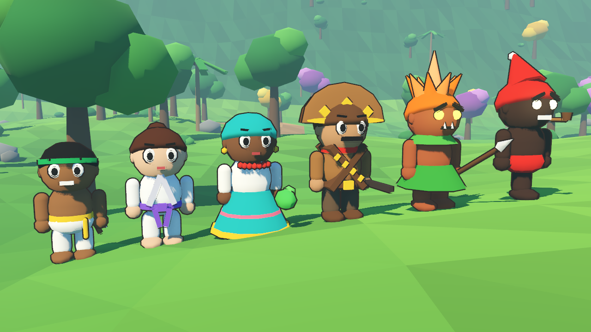

# Cordel — jogo de folclore 3D (Godot 4)

## 2026-11-16 (madrugada, continuação 4): moldura de xilogravura nos menus
- Todo menu (`Tela.fundo_papel()`, chamado pela tela de título, melhorias, opções, co-op, etc.) ganhou 4
  enfeites nos cantos no estilo xilogravura de folheto de cordel nordestino: passarinho, sol, mandacaru (cacto)
  e estrela — desenhados por código (mesmo estilo das outras artes do jogo), não por IA, porque é mais confiável
  pra um enfeite geométrico simples e pra garantir que nunca tape nenhum texto/botão.

## 2026-11-16 (madrugada, continuação 3): nome novo, logo nova, ritmo mais vivo
- **O jogo mudou de nome**: "Cordelame" virou **Cordel**. Projeto (`project.godot`), instalador (`Cordel.iss`,
  `Cordel-Instalar.exe`), atalhos, textos e os dois repositórios no GitHub (ver "Publicado no GitHub" abaixo)
  foram todos renomeados. **De propósito, NÃO mudei** o nome do arquivo de save (`user://cordelame_save.json`)
  — mudar isso faria o jogo parar de achar o progresso de quem já jogou (moedas, heróis desbloqueados, recordes).
- **Logo nova**, bem "cara de Brasil": sol de festa junina colorido, gerado por IA local (mesmo processo das
  outras artes desta madrugada), com o texto "CORDEL" desenhado por cima via código — não deixei a IA escrever
  o texto porque modelo de imagem é notoriamente ruim pra escrever letra legível; o jeito mais confiável foi gerar
  só a ilustração de fundo e escrever o título por cima do jeito que o jogo já faz nas outras telas.
- **Ritmo da partida**: o ritmo (bicho na tela, primeira carta) começava devagar demais nos primeiros minutos.
  Bicho aparece mais rápido desde o começo (intervalo de spawn começa menor e desce mais rápido, pico lá por
  7-8min em vez de só perto do chefe aos 10min), a primeira carta de nível chega um pouco mais cedo, e três
  avisos no meio da partida ("A mata tá esquentando…", "Metade do caminho!", "O chefe tá chegando…") marcam que
  o tempo tá passando. Teste novo pra isso sem precisar esperar 10 minutos de verdade: `-- --teste-ritmo`
  (avança o relógio na marra e imprime quantos bichos tem na tela a cada minuto simulado).

## 2026-11-16 — ícones de golpe de verdade, luz de três pontos nos retratos
- **7 ícones novos de verdade** (giro, chute em arco, onda, investida, tiro reto, tiro teleguiado,
  estouro), desenhados no mesmo estilo xilogravura do jogo (gerados por código, não emprestados).
  Os 84 golpes que usavam ícone emprestado de outro golpe agora usam o ícone certo do próprio tipo
  de ataque. Só os 13 golpes originais continuam com o ícone único de sempre.
- **Luz de três pontos** nos retratos 3D (principal + preenchimento + contorno por trás) e uma
  sombra suave no chão — fica com mais cara de "foto de produto", menos chapado.
- **Brilho de contorno** (rim light) nos modelos 3D de todo mundo, pra dar mais acabamento.
- Instalei Pillow/numpy (Python) nessa máquina pra gerar os ícones — ferramenta leve, sem risco.

## 2026-11-16 — Zumbi dos Palmares, Tiradentes e Irmã Dulce (32 heróis no total)
- Mais 3 heróis desbloqueáveis, pedidos por ele e feitos com cuidado e respeito: **Zumbi dos Palmares**
  (guerreiro quilombola, líder maior da resistência contra a escravidão — o desbloqueio mais difícil do
  jogo: vencer 50 chefes), **Tiradentes** (mártir da Inconfidência Mineira, "Libertas Quae Sera Tamen")
  e **Irmã Dulce** (a santa baiana dos pobres — golpes de bênção e cura, no mesmo estilo protetor da
  benzedeira). Agora são **32 heróis no total**: 10 desde o início + 22 desbloqueáveis.

## 2026-11-16 — mais 8 heróis desbloqueáveis (total 19 de ~20), correções visuais
- Mais 8 heróis desbloqueáveis: Aleijadinho (escultor), Santos Dumont (aviador), Machado de Assis
  (escritor), Marechal Rondon (sertanista), Lampião (capitão do cangaço), Maria Bonita (cangaceira),
  Carybé (muralista baiano) e Rui Barbosa (jurista orador). **29 heróis no total**: 10 desde o
  início + 19 desbloqueáveis — bem perto da meta de ~20 desbloqueáveis.
- **Pixelização do jogo reduzida** um pouco, pra não ficar tão quadriculado.
- Corrigido um bug real no retrato do maestro (Villa-Lobos): a camisa branca estava enorme e
  cobria o fraque preto inteiro. Ajustado também o martelo do escultor, que parecia um bolha solta.
- Corrigido: a carta de lenda e a carta de fase do Minhocão (chefe final) apareciam praticamente em
  branco — o bicho é gigante demais pro retrato padrão. Agora encolhe e recentraliza só pra esses
  casos.

## 2026-11-16 — mais 4 heróis desbloqueáveis (total 11 de ~20)
- Cândido Portinari (pintor), Heitor Villa-Lobos (maestro erudito), Baden Powell (violonista de
  afrosamba) e Mestre Bimba (o pai da capoeira regional) — todos desbloqueáveis por feito.
- Agora são **21 heróis no total**: 10 desde o início + 11 desbloqueáveis. Faltam mais uns 9 pra
  fechar a meta de ~20 desbloqueáveis — seguem pras próximas levas.

## 2026-11-16 — todo mundo no mesmo estilo (3D), mais 4 heróis desbloqueáveis
- **Todos os heróis agora usam o mesmo retrato 3D ao vivo** (grade de escolha, ficha e o retrato
  do canto na hora de jogar) — nenhum usa mais o sprite 2D desenhado à mão. Agora é tudo igual.
- **Mais 4 heróis desbloqueáveis** (total 7 de uma meta de ~20): Clementina de Jesus (jongueira),
  Pixinguinha (chorão/flauta), Mestre Vitalino (ceramista de Caruaru) e Elis Regina (cantora de MPB).
  Faltam mais uns 13 pra fechar a meta — seguem pras próximas levas.

## 2026-11-16 — ajustes finos pedidos por ele: ícones certos, dica confiável, menu arrumado
- Corrigido o botão SAIR colado no texto de rodapé do menu principal (menu ficou mais compacto).
- A dica de "como liberar" o herói trancado agora aparece numa faixa fixa e confiável embaixo da
  grade — não dependia só do balãozinho nativo do mouse (que às vezes não aparecia a tempo).
- Corrigido: 27 golpes novos estavam usando por engano o ícone de carta "×1,2" (de um bônus de
  atributo) como se fosse o ícone do próprio golpe — por isso pareciam "sem nada"/sem sentido.
  Agora cada golpe usa um ícone de golpe de verdade, escolhido pelo tipo de ataque (giro, chute,
  onda, investida, projétil...).
- Tentei deixar o retrato 3D dos heróis novos com o mesmo filtro pixelado do resto do jogo pra
  combinar com a arte 2D dos heróis antigos, mas quebrou a visualização (retrato ficava em branco)
  — revertido. Pra ficar IGUAL de verdade precisaria de arte 2D desenhada à mão pra cada herói novo,
  do jeito que foi feito pros 6 originais; isso é trabalho de arte, não só de código.

## 2026-11-16 — primeiros heróis desbloqueáveis, contador de dano por segundo
- **Primeiros 3 heróis desbloqueáveis por feito** (de uma meta de ~20): **Jackson do Pandeiro**
  (forrozeiro), **Mestre Pastinha** (capoeira angola) e **Dorival Caymmi** (marujo da Bahia).
  Ficam em **silhueta preta** na grade até cumprir o feito; passar o mouse mostra o que falta.
  Já vem pronto pra virar conquista da Steam no futuro (cada um já tem um id de conquista reservado).
- Requisitos desta primeira leva: Jackson pede **2.000.000 de dano numa única corrida** (precisou de
  um registro novo — "maior dano numa corrida" — separado do recorde de tempo de sobrevida); Pastinha
  pede vencer 10 chefes; Caymmi pede derrubar 10.000 bichos.
- **Contador de dano por segundo** no canto de baixo à direita da tela, durante a fase.
- Corrigido: a fileira de heróis da tela de Melhorias também não cabia mais na tela — agora rola.
- Mais heróis desbloqueáveis (até fechar os ~20 pedidos) ficam para as próximas levas.

## 2026-11-16 — 4 heróis novos, progresso do co-op separado por mundo, menu reorganizado
- **4 heróis novos jogáveis desde o início** (além dos 6 que já existiam): **Cartola** (sambista),
  **Dona Santa** (maracatuzeira), **Tião Carreiro** (violeiro) e **Mestre Verequete** (carimbozeiro) —
  nomes de gente de peso de verdade na cultura brasileira, igual os outros.
- **Progresso do co-op agora é de cada MUNDO**, separado do save sozinho (igual mundo salvo de
  Minecraft): quem hospeda dá um nome pro mundo; usar o mesmo nome continua de onde parou, nome novo
  começa do zero. Quem entra na sala de outra pessoa joga com o progresso daquele mundo emprestado —
  mesmo que já tenha personagem bem treinado no jogo sozinho, entra zerado ali (como pedido). O nome
  digitado, as teclas e as opções continuam sempre os mesmos da pessoa, em qualquer mundo.
- Menu principal agora tem dois botões claros no topo: **UM JOGADOR** e **MULTIJOGADOR (LAN)**.
- A ficha do herói mostra a descrição logo em cima, antes das estatísticas.
- Corrigido: a fileira de fases na tela de escolher herói não cabia mais na tela com 15 fases —
  agora rola na horizontal.

## 2026-11-16 — 15 fases e chefão final: o Minhocão
- O jogo agora tem **15 fases** (antes eram 4), cada uma mais forte que a anterior, com nomes de lugares do
  Brasil (Pantanal, Caatinga, Chapada Diamantina, Lençóis Maranhenses, Pampa Gaúcho...).
- Chefão final (fase 15, "Coração da Amazônia"): o **MINHOCÃO**, lenda de verdade avistada em jornais do
  interior de SP/PR no século 19 — verme gigante de couro grosso. Alterna pisão que estremece tudo e
  arrancada por baixo da terra; enfurecido, também cospe fogo. Reaproveita os mesmos sistemas de combate
  dos outros chefes (sem risco de quebrar nada), só que combinados num chefão de verdade "fodão".
- As fases do meio reaproveitam os 4 chefes já existentes (Mapinguari, Mula sem Cabeça, Boitatá, Cuca) com
  nomes e força crescente, em vez de inventar um chefe novo pra cada uma — mais rápido e seguro de testar,
  e combina com histórias de lenda que voltam mais fortes a cada vez.

## 2026-11-16 — mapa só aumenta no canto, placar corrigido, bichos mais fortes no co-op
- O mapa grande (segurar Tab) agora só AUMENTA o minimapa do cantinho no lugar — não cobre mais a tela.
- Corrigido um bug sério: o Godot sempre bota um "peer" padrão mesmo sozinho, e isso fazia o jogo achar
  que o co-op tava sempre ligado (mesmo jogando sozinho). Agora `Rede.ativo()` só é `true` depois que
  alguém realmente hospeda ou entra numa sala — isso que deixava o placar (Tab) vazio.
- Placar do Tab (build sua e de todo mundo, estilo League of Legends) confirmado funcionando.
- Co-op testado de verdade com 2 processos reais: posição, bichos, dano e XP/moedas compartilhados
  continuam sincronizando certinho depois da correção acima.
- Balanceado: cada pessoa a mais conectada no co-op deixa os bichos mais fortes, mais numerosos e que
  nascem mais rápido (até +40% de bichos e +140% de força com a sala cheia de 5), pra não ficar fácil demais.

*(Prints de verdade do jogo rodando: o arraial no meio do mapa, a muralha de mata na borda e os bonecos.)*

Jogo 3D em terceira pessoa no estilo dos "survivors 3D": bonecos cabeçudos com contorno, câmera atrás do
herói que gira com o mouse, uma clareira com arraial de São João no meio e **mata amazônica fechada em volta**
(é o limite do mapa: não dá para passar, e é de lá que os bichos saem). Tudo é montado por código.

## Como abrir e jogar
**Jeito fácil:** dois cliques no atalho **Cordel** da Área de Trabalho (ou no `JOGAR.bat`, na pasta de cima).
O motor do jogo já está junto, na pasta `motor`; não precisa instalar nada. `EDITAR.bat` abre o editor.

**Jeito manual:**
1. Baixe o **Godot 4.3 ou mais novo** em https://godotengine.org/download (é um programa só, não precisa instalar).
2. Abra o Godot → **Importar** → aponte para a pasta `godot` (a que tem o arquivo `project.godot`) → **Importar e Editar**.
3. Aperte **F5** (ou o ▶ no canto superior direito) para jogar.

## Controles
- **WASD / setas** — andar (em relação à câmera)
- **Mouse** — girar a câmera · **Roda** — zoom · **Esc** — pausa (continuar, opções, sair para o arraial)
- **Espaço** — pular (dá para pular por cima dos bichos pequenos)
- **Shift** — esquiva (arranca e fica intocável um instante)
- **Q** — especial da classe (tem recarga) · **R** — ultimate (carrega a cada 60 abates)
- **F** — sair da fase com o que ganhou (só depois de vencer o chefe)
- **1 / 2 / 3** — escolher a carta ao subir de nível (ou clique nela)

## Crítico
Todo golpe de toda classe pode sair crítico (5% de base, ×2 de dano). As cartas *Olho de Cobra* (chance) e
*Peixeira Amolada* (dano crítico) empilham; chance acima de 100% vira crítico duplo e, acima de 200%, triplo —
cada degrau multiplica de novo. A pausa mostra o maior golpe e o dano total da partida.

## Telas
Capa, escolha de herói/fase, melhorias, opções (som, jogo, idioma em breve), pausa, cartas e fim de partida ficam em
`scripts/Menus.gd`; o estilo de cordel (papel, tinta, botões) em `scripts/Tela.gd`; a arte vinda do jogo 2D em `art/cordel`.
Prints de conferência: `-- --tela titulo|herois|melhorias|opcoes|pausa|nivel|fim|jogo`.
- **Enter** — voltar ao arraial depois que a partida acaba

## Classes (cada uma só recebe golpes da própria luta)
- **Capoeirista** — golpes em roda ao redor dele: Armada, Meia-Lua, Rasteira, Toque de Berimbau. Esquiva.
- **Lutadora de Jiu-Jitsu** — Kimura (investida), Queda de Baiana, Raspagem. Fica intocável durante a investida,
  **fecha a guarda** ao chegar (toma 35% menos dano por um instante) e **se cura quando finaliza** um bicho com a Kimura.
- **Benzedeira** — ataca de longe: Fogo-Fátuo teleguiado (estoura no alvo; a cada 2 níveis sai mais um),
  Garrafada e Reza Forte. Regenera vida.
- **Cangaceiro** — Peixeira, Bacamarte e Rifle. Crítico.

## Como é uma fase
1. **10 minutos** de bichos engrossando aos poucos. De tempos em tempos vem um **elite** (bicho normal, dourado,
   com mais vida e mais dano).
2. Aos 10 minutos aparece o **chefe**, que é outra criatura, com ataque próprio:
   **Mapinguari** (pisão em volta — dá para escapar pulando), **Mula sem Cabeça** (disparada em linha reta) e
   **Boitatá** (cospe bolas de fogo).
3. Você tem **3 minutos** para vencer. Passou disso, o chefe **enfurece** e a mata despeja bicho.
4. Chefe vencido: a fase vira **infinita**, com cada vez mais bicho e mais forte. Cada bicho passa a valer mais
   moedas quanto mais tempo você aguenta, e o tempo extra vira **recorde** da fase.
5. Acabou (caiu, ou saiu com **F**): volta ao **arraial**, que é o menu. Lá você escolhe herói e fase e gasta as
   moedas em **melhorias permanentes**. Vencer o chefe libera a fase seguinte. Cair antes do chefe paga metade.

## Especial e ultimate
- **Capoeirista** — Q: Aú · R: Roda de Capoeira
- **Lutadora** — Q: Mata-Leão · R: Finalização!
- **Benzedeira** — Q: Benção (cura) · R: Chuva de Fogo-Fátuo
- **Cangaceiro** — Q: Tiro Certeiro · R: Bando de Lampião

## Cartas ao subir de nível (3 opções)
- **Melhorar um golpe seu** (até o nível 8; +25% de dano por nível) ou **ganhar um golpe novo da sua classe**.
- **Atributos**: dano, vida, velocidade, velocidade de ataque, crítico, armadura, regeneração, alcance de XP, área.
- Toda carta vem com **raridade** (Comum, Incomum, Rara, Épica, Lendária): quanto mais rara, maior o efeito.
- Existe ainda a **Mítica**: vem 1 vez a cada 500 cartas e é roubada de propósito (12× o efeito de uma comum, ou +5 níveis no golpe).

## Testes automáticos (rodam sem tela)
- `godot --headless --fixed-fps 60 --quit-after 900 -- --teste cangaceiro` — 6 segundos com todos os golpes da classe.
- `godot --headless --fixed-fps 30 --quit-after 9200 -- --bot jiujitsu` — um robô joga uma partida de até 5 minutos,
  pega cartas sozinho e diz quanto durou, nível e abates.
- Para o robô encontrar o chefe logo: acrescente `--chefe-em 60 --tempo 420 --fase 2`.
- Prints: `godot --path . -- --shot <classe>`, `-- --galeria`, `-- --borda`, `-- --chefe` e `-- --menu`.
- Nos testes o jogo não lê nem grava o save do jogador.

## Onde está cada coisa
- `scripts/World.gd` — o mundo: céu, chão, mata, muralha, arraial, câmera, ondas, golpes, efeitos, HUD.
- `scripts/Player.gd` — o herói: andar, pular, esquiva, vida, nível, cartas.
- `scripts/Enemy.gd` — as criaturas.
- `scripts/Boneco.gd` — os bonecos 3D (heróis e bichos) e a animação deles.
- `scripts/Data.gd` — tabela das classes, golpes, atributos, raridades, habilidades, fases e melhorias.
- `scripts/Save.gd` — o que fica guardado: moedas, fases liberadas, melhorias, recordes e contadores.
- `scripts/Lib.gd` — peças low-poly, materiais e a altura do terreno.

## Ainda falta (ver PLANO-3D-STEAM.md)
Itens, Feira, mais criaturas, cenário diferente por fase (hoje muda só a luz), música e sons.

**Personagens para desbloquear** (ideia: uns 20, começando com 3): liberar por feito, tipo "mate 150 sacis",
"vença o mini-chefe de tal canto do mapa" ou "aplique 150 kimuras para virar Mestre de Jiu-Jitsu". O jogo já
conta abates por criatura e usos de cada golpe no save (`contadores`), que é a base para isso.

**Para o fim, antes da Steam:** traduzir o jogo para várias línguas (inglês, espanhol e outras). Todo texto novo
deve ficar em tabela (`Data.gd`) para a tradução ser só trocar a tabela.

## Novidades de 16/11 (madrugada)
- **HUD**: retrato + vida (com rastro do dano) + XP embaixo, quadrinhos de golpes/Q/R com recarga, mini inventário das cartas,
  minimapa, sequência de abates, painel da build no Tab. `scripts/MiniMapa.gd`.
- **Controles**: teclas trocáveis em Opções > Controles e controle de Xbox/PlayStation (`scripts/Ctrl.gd`).
- **Sons, vozes e música** provisórios em `som/` (gerados por script; troque o .wav mantendo o nome). `scripts/Som.gd`.
- **Visual pixelado** estilo PS1 (liga/desliga nas opções) e animação "aos pulinhos".
- **Pelo mapa**: potes, baús (de graça de elite/chefe, ou pagos com moedas da partida), oratórios (fique perto para carregar),
  Bodega do Lampião (contrabando, troca-troca, pacto...) e o Portal da Cuca (mini-chefe).
- **Bicharada nova**: Curupira, Corpo-Seco, Iara (atira de longe), Lobisomem (dá bote), Boto; cada uma tem ficha com a lenda
  na primeira vez que aparece (`Dados.LORE`, pronto para tradução).
- **Heróis mais únicos**: apelido, pulo próprio de cada um, carta de pulo duplo (Pulo do Saci).
- **Tutorial** na primeira partida (dá para refazer em Opções > Jogo). **Feitos** que pagam moedas. Mítica agora é 1 em 100.
- Testes: `-- --bot <classe> --melhorias N` joga com as melhorias compradas no nível N.
- Pacote para amigos: `Cordel-teste.zip` na pasta de cima (extrair e abrir `JOGAR.bat`).

## Ainda falta
Itens ativos, cenário diferente por fase, mais chefes e personagens desbloqueáveis por feito, sons/vozes definitivos,
tradução (os textos ainda estão soltos no código), coop Steam/LAN, exportação "de verdade" (.exe próprio) e, bem depois, celular.

## Novidades de 16/11 (manhã)
- **Gente do mapa** (aliados, três sorteados por partida): Seu Zé Pilintra, Pomba Gira, Preto Velho, Baiana do Acarajé,
  Zé do Repente e Vaqueiro Aboiador. Cada um tem retrato 3D, balão com 5 falas que se alternam e 3 ofertas (`Dados.NPCS`).
- **Poderes temporários** (`Dados.PODERES`): vencer a Cuca vira você na Mula sem Cabeça (rastro de fogo); elites podem dar
  Fúria do Lobisomem, Canto da Iara, Pé de Curupira, Redemoinho do Saci, Encanto do Boto, Couro de Corpo-Seco, Protegido da Mata.
- **Melhorias por personagem** (`Salvo.nivel` / `Salvo.subir`); as moedas continuam sendo uma só carteira.
- **Fase 4, Corcovado**, com o Cristo Redentor ao fundo. Tutorial também na capa.
- Testes novos: `-- --bot <classe> --tut` (tutorial inteiro), `--extras` (pombas, guarda do Seu Zé), `--poder todos`,
  `--tela <nome do aliado> --npc <nome>`.

## Novidades de 16/11 (noite): retratos de verdade via IA local
- Os 28 heróis desbloqueáveis que ainda caíam no boneco 3D genérico agora têm um retrato pintado de verdade
  (igual os 6 originais), gerado por IA rodando no próprio computador (sem gastar nada em serviço de nuvem):
  modelo `kohbanye/pixel-art-style` (Stable Diffusion treinado em pixel art) via `diffusers`, fundo removido
  com `rembg`. Deu pra rodar só na CPU (26 passos, 448x576) — ~2min por herói, lote de 28 em ~1h.
- **Achado real**: `s_maracatuzeiro.png` não importava no Godot (erro silencioso, sem motivo aparente). A causa
  era o limite de 260 caracteres do Windows no caminho — o nome do arquivo de cache fica gigante dentro da pasta
  de projeto. Corrigido renomeando pra nomes curtos (`s_maracatu.png`, `s_cangchefe.png`) com um dicionário de
  "apelido de arquivo" no código (`Menus.APELIDO_ARQUIVO`) pra não precisar mudar o id do herói em lugar nenhum.
- Regressão completa nos 32 heróis (headless, sem erro de script).

## Novidades de 16/11 (madrugada): placas legíveis, mundo achado sozinho, gente do mapa mais rara
- **BUG REAL achado e corrigido**: de longe, as placas flutuantes (ORATÓRIO, nome dos aliados) ficavam ilegíveis,
  um borrão de pixel — o filtro de pixelização "comia" os traços finos da letra. Corrigido deixando a letra e o
  contorno bem mais grossos (`World._placa()`), sem precisar mexer no filtro em si.
- **BUG REAL achado e corrigido**: os golpes automáticos continuavam disparando/girando mesmo sem nenhum bicho por
  perto (ex.: parado conversando com a Baiana). Como eles miram em "quem está na mira" por padrão quando não acham
  bicho, de longe parecia que estavam "mirando" na gente do mapa — mas o dano nunca ia pra eles (só bicho de verdade
  recebe dano). Agora, sem bicho na tela, o herói simplesmente não atira/golpeia à toa.
- **Gente do mapa mais rara**: antes eram sempre 3 fixos a partida inteira; agora é só 1 ou 2, e cada um some sozinho
  depois de um tempo (50 a 85s), em vez de ficar pra sempre no mapa — a ideia é ser um encontro ocasional, não mobília.
- **Mundo hospedado agora é achado sozinho**: a tela de "entrar" no co-op escuta um anúncio UDP que o anfitrião manda
  na rede local; se tiver alguém hospedando por perto, aparece um botão "ENTRAR EM: <nome do mundo>" pronto, sem
  precisar digitar IP (o campo de IP continua ali, como alternativa). Confirmado que o anúncio sai certo pela rede
  de verdade (testado com um ouvinte UDP externo); num PC só com duas janelas do jogo ao mesmo tempo, só uma das duas
  consegue ESCUTAR o anúncio (as duas não podem abrir a mesma porta ao mesmo tempo no mesmo PC) — em computadores
  diferentes (o uso de verdade) isso não é problema, cada um tem sua própria rede de portas.
- Mais uma leva de retratos de IA local: `benzedeira` e `violonista` (dos "4 primeiros" que ainda usavam o boneco
  3D ou a arte 2D antiga) ganharam retrato de IA local de verdade. `capoeirista`, `jiujitsu` e `cangaceiro` ficaram
  com a arte original (tentei gerar por IA, mas saiu com defeito de recorte de fundo ou um estilo bem diferente do
  resto do jogo em todas as tentativas — decidi não trocar uma arte boa por uma pior). `frevista` perdeu o retrato
  de IA que tinha saído quebrado (ficava quase todo transparente) e voltou a cair no boneco 3D, que já ficou bom
  com a luz de três pontos da leva anterior.

## Novidades de 16/11 (madrugada, continuação): alcance melee, carta real do Machado e ícone de Q/R próprio
- **Alcance dos golpes corpo-a-corpo maior**: todo golpe de giro/chute/investida (`ring`/`arco`) ficou com 20% mais
  área, e os golpes de investida/agarrão (`investida`, tipo Kimura) alcançam 15% mais longe — sentia curto perto
  de quem joga à distância. A carta "Roda Grande" (+área dos golpes) já existia e segue empilhando em cima disso.
- **Carta dos vermes** ("Verme que Roeu as Frias Carnes") agora cita de verdade a abertura de Machado de Assis em
  Memórias Póstumas de Brás Cubas: "Ao verme que primeiro roeu as frias carnes do meu cadáver. — Brás Cubas".
- **BUG REAL achado e corrigido**: as habilidades Q e R de cada herói usavam um conjunto pequeno de 11 ícones
  reaproveitados entre heróis sem nada a ver (ex.: "Mote Cortante" do Cordelista e "Malandragem" do Sambista
  mostravam o ÍCONE IGUAL, mesmo sendo habilidades totalmente diferentes). Agora cada um dos 32 heróis tem seu
  próprio par de ícones de Q/R, gerados na cor da própria classe (estrela dourada pro Q, espiral pro R).
  Conferido também que todo golpe/atributo/habilidade/melhoria/item de loja tem imagem de verdade (nenhum faltando).

## Novidades de 16/11 (madrugada, continuação 2): mapa de verdade no co-op
- **O MAIOR BURACO do co-op até agora**: pote, baú, oratório, loja, portal e gente do mapa simplesmente NÃO
  EXISTIAM na partida em grupo (só no sozinho) — não era "não sincronizado", era "não aparecia". Agora o anfitrião
  monta o mapa (`_montar_objetos()`) e manda cada objeto pros convidados por RPC; todo mundo vê exatamente os
  mesmos potes/baús/oratórios/loja/portal/gente, nas mesmas posições.
- Quando alguém pega um pote, abre um baú, ou um NPC vai embora, isso some pro grupo inteiro (não só na tela de
  quem fez), pra ninguém ver uma coisa "fantasma" que já foi usada. Oratório não some (continua sendo um altar),
  só fica "apagado" (sem luz/placa) pros dois depois de completar.
- O portal pra Cuca (chefe bônus) agora também funciona em grupo: se for o convidado que entra no portal, ele pede
  pro anfitrião (só ele tem autoridade pra fazer bicho nascer de verdade pela rede) — e a Cuca aparece pros dois.
- Testado de verdade com dois processos reais conectados pela rede (não só no mesmo processo): confirmado que o
  número de objetos bate igual nos dois lados, e que pegar um pote num lado soma no outro na mesma hora.
- Ainda ficou de fora desta leva (vai ficar pra próxima vez): a carta de nível não aparece visualmente pro parceiro
  quando o outro sobe de nível (ele sobe normal, só não é visto); loja/baú continuam com economia pessoal (cada um
  paga com sua própria moeda, o que já fazia sentido assim).

## Distribuir
`python instalador/publicar.py [endereço]` gera em `dist/`: `Cordel-Instalar.exe` (instala sem senha de administrador e cria
atalho) e `jogo.zip` + `versao.txt`. O jogo instalado abre por `Jogar.ps1`, que, se houver endereço em `atualizacao.txt`,
compara o `versao.txt` de lá com o local e baixa o `jogo.zip` novo antes de abrir. O endereço precisa ser acessível sem login.

## Publicado no GitHub
- Código-fonte (privado): https://github.com/diogobennertz/cordel
- Para os colegas baixarem e jogarem (público, só os arquivos prontos): https://github.com/diogobennertz/cordel-jogo/releases/latest
- Para publicar uma versão nova depois de mexer no jogo: `bash instalador/publicar_github.sh "mensagem"` (sobe o código, gera o
  instalador, sobe a atualização e cria a release — tudo de uma vez). Quem já instalou recebe a atualização sozinho ao abrir o jogo.
- Para testar o instalador sem bagunçar o atalho de quem está desenvolvendo: `powershell instalador/testar.ps1`.

## Correções de 16/11 (tarde)
- **Tutorial travava** no passo da arrancada: apertar Shift sem segurar uma direção não fazia nada (a arrancada exige
  estar andando). Agora, nesse passo, a arrancada funciona mesmo parado (`Jogador.forcar_dash()`).
- **Tutorial travava (benzedeira e qualquer jogo à distância)** no passo do XP: os bichos morriam de longe, mas os
  vaga-lumes nunca eram alcançados. Agora, depois que os bichos do passo morrem, os vaga-lumes vêm sozinhos até o herói.
- **Passo do XP não nascia bicho nenhum**: antes, o passo criava os vaga-lumes do nada; agora nascem bichos de verdade,
  que soltam os vaga-lumes ao morrer — como o próprio texto do tutorial explica.
- **Minimapa**: o ícone do portal não aparecia (erro de ordem no `match`); agora aparece, e o minimapa inteiro ficou
  bem maior (de ~122px para ~192px), com os pontos maiores e uma seta mostrando o herói.
- **Mapa maior**: a clareira jogável cresceu de raio 42 para 60 (mais que o dobro de área); grama e flores mais densas.
- Novo teste: `-- --teste-dash` confere isoladamente a arrancada parada.

## Novidades de 16/11 (mapa grande, tutorial opcional, escolha de herói em grade)
- **Tecla M (configurável)**: abre um mapa grande no meio da tela, com legenda escrita (Baú, Bodega, Oratório, Portal e o
  nome de cada entidade). ESC, Start do controle ou M de novo fecha. O minimapa do canto também ficou maior.
- **Tutorial opcional**: ao clicar JOGAR pela 1ª vez, o jogo pergunta "Sim/Não" em vez de forçar. A resposta não impede
  jogar de novo o tutorial pelo botão TUTORIAL do menu principal (ou em Opções > Jogo), a qualquer momento.
- **Escolha de herói em grade**: os heróis agora aparecem como ícones pequenos numa grade rolável à esquerda; a ficha
  completa (vida, golpes, Q/R, pulo) do herói escolhido fica à direita. Pensado para escalar até ~20 personagens.

## Novidades de 16/11 (mapa no Tab, herói do tutorial, mais 2 heróis)
- **Mapa grande agora é no Tab (segurar)**, não mais M: o jogo continua rodando e dá pra se mexer olhando o mapa, que
  ocupa uns 60% da tela (escala com a resolução). Tab também mostra a build (os dois painéis juntos).
- **Escolher herói antes do tutorial**: os botões "TUTORIAL" (capa e opções) agora levam pra tela de escolha de herói
  primeiro, em vez de pegar direto o último usado.
- **Bia Gracie** (estava "Bia Grace" por engano).
- **2 heróis novos**, com apelido de gente de peso de verdade, como você pediu:
  - **Capiba** (passista de frevo) — o nome é do Capiba de verdade, um dos maiores compositores de frevo que já existiu.
    Rápido e esquivo, sombrinha na mão; golpes Tesoura/Parafuso/Ferrugem (passos reais de frevo).
  - **Patativa do Assaré** (repentista de cordel) — nome do poeta/repentista mais famoso do Nordeste; combina até com o
    nome do jogo. Ataca de longe com versos (Repente/Glosa/Desafio).
  - Os dois já têm boneco 3D de verdade, golpes, Q, R, pulo e passam no robô de teste. O retrato deles no menu ainda é
    um render 3D provisório (os outros 4 têm ilustração 2D desenhada à mão) — troca sozinho assim que eu desenhar a arte certa.

## Co-op em LAN (começado agora, AINDA NÃO CONFIRMADO funcionando de verdade)
- Base real usando o sistema de multiplayer do próprio Godot (ENet): `scripts/Rede.gd` (autoload `Rede`) hospeda/entra
  numa sala por IP local, até 5 pessoas; `Menus.coop()` é a tela (botão "CO-OP (LAN)" na capa); `World.iniciar_coop()` +
  `_spawnar_jogador_rede()` criam um `Jogador` por pessoa conectada, com `MultiplayerSynchronizer` replicando posição
  e rotação; `Player.gd` ignora input de quem não é "dono" do boneco (`get_multiplayer_authority()`).
- **CONFIRMADO FUNCIONANDO** (movimento, nomes, bicho, mapa, combate e recompensa): dois processos reais do jogo
  (com janela — em `--headless` a conexão trava, não descobri bem por quê, mas o jogo de verdade nunca roda
  headless) se conectam, cada um tem o nome escolhido escrito em cima da cabeça, e agora:
  - O anfitrião monta o mapa (pote/baú/oratório/loja/portal/gente) e manda tudo pros convidados por RPC
    (`World._novo_objeto` → `_spawnar_objeto_rede`); todo mundo vê os mesmos objetos nas mesmas posições.
    Quem usa um objeto (pega pote, abre baú, portal, gente que foi embora) avisa o grupo inteiro
    (`_remover_objeto_rede`/`_marcar_objeto_usado_rede`), pra não sobrar "fantasma" na tela de quem não usou.
  - O anfitrião manda nascer e morrer os bichos pra todo mundo ver (`World._replicar_bicho`, `_spawnar_inimigo_rede`,
    `_remover_inimigo_rede`), inclusive a Cuca que sai do portal (se for o convidado que usa o portal, ele pede
    pro anfitrião com `_pedir_cuca_rede`, já que só o anfitrião tem autoridade pra fazer bicho nascer de verdade).
    Os bichos perseguem quem estiver mais perto, seja quem for (`World._alvo_mais_perto`).
  - Golpe de QUALQUER jogador mata o bicho de verdade: se o bicho não é "seu" (é do anfitrião), o golpe vira um pedido
    pela rede (`retransmitir_dano`) e o anfitrião aplica de verdade.
  - Bicho que encosta em alguém manda a dor pela rede pra pessoa certa (`ferir_jogador`/`_sofrer_dano`), não só em quem hospeda.
  - **XP e moeda são compartilhados**: toda vez que um bicho morre, todo mundo na sala ganha o mesmo tanto (`_premiar_abate`),
    não só quem deu o golpe final — assim ninguém fica para trás.
  - Protegido contra erro se alguém desconectar no meio da luta (`_peer_aqui`).
  - Conferido no código (já funcionava desde antes, só não estava documentado): o chefe de verdade da fase
    também já nasce e enfurece replicado pros dois (`_dirigir()` já era só-anfitrião, `_marcar_furia_rede`),
    com barra de vida e aviso aparecendo certo pro convidado.
  - Ainda NÃO entrou: a carta de subir de nível de cada um não aparece visualmente pro parceiro (hoje cada um
    ainda sobe sozinho, sem avisar o outro — funciona, só não é visto). Loja/baú continuam com economia pessoal
    de propósito (cada um paga com a própria moeda).
  - Testes: `-- --coop-host` e `-- --coop-join <ip>` (cria um bicho de teste, teleporta o anfitrião até um pote pra
    confirmar que o consumo soma igual nos dois lados, separa os jogadores e confere dano/XP/moeda/objetos nos
    dois lados pelos registros — sem precisar jogar na mão).
