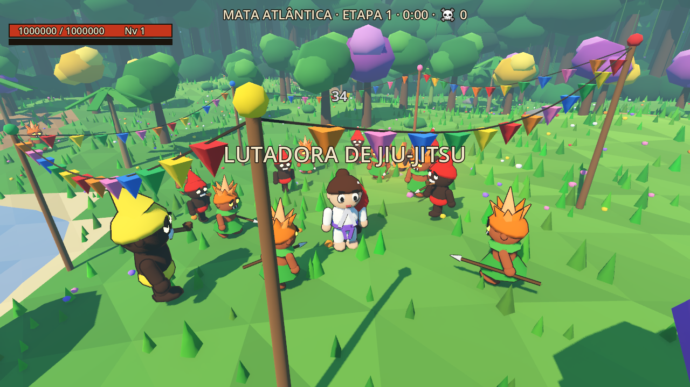
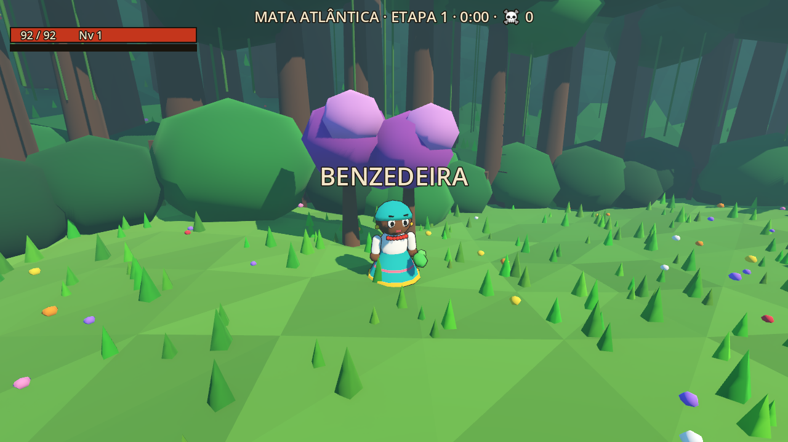

# Cordelame — jogo de folclore 3D (Godot 4)

*(Prints de verdade do jogo rodando: o arraial no meio do mapa, a muralha de mata na borda e os bonecos.)*

Jogo 3D em terceira pessoa no estilo dos "survivors 3D": bonecos cabeçudos com contorno, câmera atrás do
herói que gira com o mouse, uma clareira com arraial de São João no meio e **mata amazônica fechada em volta**
(é o limite do mapa: não dá para passar, e é de lá que os bichos saem). Tudo é montado por código.

## Como abrir e jogar
**Jeito fácil:** dois cliques no atalho **Cordelame** da Área de Trabalho (ou no `JOGAR.bat`, na pasta de cima).
O motor do jogo já está junto, na pasta `motor`; não precisa instalar nada. `EDITAR.bat` abre o editor.

**Jeito manual:**
1. Baixe o **Godot 4.3 ou mais novo** em https://godotengine.org/download (é um programa só, não precisa instalar).
2. Abra o Godot → **Importar** → aponte para a pasta `godot` (a que tem o arquivo `project.godot`) → **Importar e Editar**.
3. Aperte **F5** (ou o ▶ no canto superior direito) para jogar.

## Controles
- **WASD / setas** — andar (em relação à câmera)
- **Mouse** — girar a câmera · **Roda** — zoom · **Esc** — pausa (continuar, opções, sair para o arraial)
- **Espaço** — pular (dá para pular por cima dos bichos pequenos)
- **Shift** — esquiva (arranca e fica intocável um instante)
- **Q** — especial da classe (tem recarga) · **R** — ultimate (carrega a cada 60 abates)
- **F** — sair da fase com o que ganhou (só depois de vencer o chefe)
- **1 / 2 / 3** — escolher a carta ao subir de nível (ou clique nela)

## Crítico
Todo golpe de toda classe pode sair crítico (5% de base, ×2 de dano). As cartas *Olho de Cobra* (chance) e
*Peixeira Amolada* (dano crítico) empilham; chance acima de 100% vira crítico duplo e, acima de 200%, triplo —
cada degrau multiplica de novo. A pausa mostra o maior golpe e o dano total da partida.

## Telas
Capa, escolha de herói/fase, melhorias, opções (som, jogo, idioma em breve), pausa, cartas e fim de partida ficam em
`scripts/Menus.gd`; o estilo de cordel (papel, tinta, botões) em `scripts/Tela.gd`; a arte vinda do jogo 2D em `art/cordel`.
Prints de conferência: `-- --tela titulo|herois|melhorias|opcoes|pausa|nivel|fim|jogo`.
- **Enter** — voltar ao arraial depois que a partida acaba

## Classes (cada uma só recebe golpes da própria luta)
- **Capoeirista** — golpes em roda ao redor dele: Armada, Meia-Lua, Rasteira, Toque de Berimbau. Esquiva.
- **Lutadora de Jiu-Jitsu** — Kimura (investida), Queda de Baiana, Raspagem. Fica intocável durante a investida,
  **fecha a guarda** ao chegar (toma 35% menos dano por um instante) e **se cura quando finaliza** um bicho com a Kimura.
- **Benzedeira** — ataca de longe: Fogo-Fátuo teleguiado (estoura no alvo; a cada 2 níveis sai mais um),
  Garrafada e Reza Forte. Regenera vida.
- **Cangaceiro** — Peixeira, Bacamarte e Rifle. Crítico.

## Como é uma fase
1. **10 minutos** de bichos engrossando aos poucos. De tempos em tempos vem um **elite** (bicho normal, dourado,
   com mais vida e mais dano).
2. Aos 10 minutos aparece o **chefe**, que é outra criatura, com ataque próprio:
   **Mapinguari** (pisão em volta — dá para escapar pulando), **Mula sem Cabeça** (disparada em linha reta) e
   **Boitatá** (cospe bolas de fogo).
3. Você tem **3 minutos** para vencer. Passou disso, o chefe **enfurece** e a mata despeja bicho.
4. Chefe vencido: a fase vira **infinita**, com cada vez mais bicho e mais forte. Cada bicho passa a valer mais
   moedas quanto mais tempo você aguenta, e o tempo extra vira **recorde** da fase.
5. Acabou (caiu, ou saiu com **F**): volta ao **arraial**, que é o menu. Lá você escolhe herói e fase e gasta as
   moedas em **melhorias permanentes**. Vencer o chefe libera a fase seguinte. Cair antes do chefe paga metade.

## Especial e ultimate
- **Capoeirista** — Q: Aú · R: Roda de Capoeira
- **Lutadora** — Q: Mata-Leão · R: Finalização!
- **Benzedeira** — Q: Benção (cura) · R: Chuva de Fogo-Fátuo
- **Cangaceiro** — Q: Tiro Certeiro · R: Bando de Lampião

## Cartas ao subir de nível (3 opções)
- **Melhorar um golpe seu** (até o nível 8; +25% de dano por nível) ou **ganhar um golpe novo da sua classe**.
- **Atributos**: dano, vida, velocidade, velocidade de ataque, crítico, armadura, regeneração, alcance de XP, área.
- Toda carta vem com **raridade** (Comum, Incomum, Rara, Épica, Lendária): quanto mais rara, maior o efeito.
- Existe ainda a **Mítica**: vem 1 vez a cada 500 cartas e é roubada de propósito (12× o efeito de uma comum, ou +5 níveis no golpe).

## Testes automáticos (rodam sem tela)
- `godot --headless --fixed-fps 60 --quit-after 900 -- --teste cangaceiro` — 6 segundos com todos os golpes da classe.
- `godot --headless --fixed-fps 30 --quit-after 9200 -- --bot jiujitsu` — um robô joga uma partida de até 5 minutos,
  pega cartas sozinho e diz quanto durou, nível e abates.
- Para o robô encontrar o chefe logo: acrescente `--chefe-em 60 --tempo 420 --fase 2`.
- Prints: `godot --path . -- --shot <classe>`, `-- --galeria`, `-- --borda`, `-- --chefe` e `-- --menu`.
- Nos testes o jogo não lê nem grava o save do jogador.

## Onde está cada coisa
- `scripts/World.gd` — o mundo: céu, chão, mata, muralha, arraial, câmera, ondas, golpes, efeitos, HUD.
- `scripts/Player.gd` — o herói: andar, pular, esquiva, vida, nível, cartas.
- `scripts/Enemy.gd` — as criaturas.
- `scripts/Boneco.gd` — os bonecos 3D (heróis e bichos) e a animação deles.
- `scripts/Data.gd` — tabela das classes, golpes, atributos, raridades, habilidades, fases e melhorias.
- `scripts/Save.gd` — o que fica guardado: moedas, fases liberadas, melhorias, recordes e contadores.
- `scripts/Lib.gd` — peças low-poly, materiais e a altura do terreno.

## Ainda falta (ver PLANO-3D-STEAM.md)
Itens, Feira, mais criaturas, cenário diferente por fase (hoje muda só a luz), música e sons.

**Personagens para desbloquear** (ideia: uns 20, começando com 3): liberar por feito, tipo "mate 150 sacis",
"vença o mini-chefe de tal canto do mapa" ou "aplique 150 kimuras para virar Mestre de Jiu-Jitsu". O jogo já
conta abates por criatura e usos de cada golpe no save (`contadores`), que é a base para isso.

**Para o fim, antes da Steam:** traduzir o jogo para várias línguas (inglês, espanhol e outras). Todo texto novo
deve ficar em tabela (`Data.gd`) para a tradução ser só trocar a tabela.

## Novidades de 16/11 (madrugada)
- **HUD**: retrato + vida (com rastro do dano) + XP embaixo, quadrinhos de golpes/Q/R com recarga, mini inventário das cartas,
  minimapa, sequência de abates, painel da build no Tab. `scripts/MiniMapa.gd`.
- **Controles**: teclas trocáveis em Opções > Controles e controle de Xbox/PlayStation (`scripts/Ctrl.gd`).
- **Sons, vozes e música** provisórios em `som/` (gerados por script; troque o .wav mantendo o nome). `scripts/Som.gd`.
- **Visual pixelado** estilo PS1 (liga/desliga nas opções) e animação "aos pulinhos".
- **Pelo mapa**: potes, baús (de graça de elite/chefe, ou pagos com moedas da partida), oratórios (fique perto para carregar),
  Bodega do Lampião (contrabando, troca-troca, pacto...) e o Portal da Cuca (mini-chefe).
- **Bicharada nova**: Curupira, Corpo-Seco, Iara (atira de longe), Lobisomem (dá bote), Boto; cada uma tem ficha com a lenda
  na primeira vez que aparece (`Dados.LORE`, pronto para tradução).
- **Heróis mais únicos**: apelido, pulo próprio de cada um, carta de pulo duplo (Pulo do Saci).
- **Tutorial** na primeira partida (dá para refazer em Opções > Jogo). **Feitos** que pagam moedas. Mítica agora é 1 em 100.
- Testes: `-- --bot <classe> --melhorias N` joga com as melhorias compradas no nível N.
- Pacote para amigos: `Cordelame-teste.zip` na pasta de cima (extrair e abrir `JOGAR.bat`).

## Ainda falta
Itens ativos, cenário diferente por fase, mais chefes e personagens desbloqueáveis por feito, sons/vozes definitivos,
tradução (os textos ainda estão soltos no código), coop Steam/LAN, exportação "de verdade" (.exe próprio) e, bem depois, celular.

## Novidades de 16/11 (manhã)
- **Gente do mapa** (aliados, três sorteados por partida): Seu Zé Pilintra, Pomba Gira, Preto Velho, Baiana do Acarajé,
  Zé do Repente e Vaqueiro Aboiador. Cada um tem retrato 3D, balão com 5 falas que se alternam e 3 ofertas (`Dados.NPCS`).
- **Poderes temporários** (`Dados.PODERES`): vencer a Cuca vira você na Mula sem Cabeça (rastro de fogo); elites podem dar
  Fúria do Lobisomem, Canto da Iara, Pé de Curupira, Redemoinho do Saci, Encanto do Boto, Couro de Corpo-Seco, Protegido da Mata.
- **Melhorias por personagem** (`Salvo.nivel` / `Salvo.subir`); as moedas continuam sendo uma só carteira.
- **Fase 4, Corcovado**, com o Cristo Redentor ao fundo. Tutorial também na capa.
- Testes novos: `-- --bot <classe> --tut` (tutorial inteiro), `--extras` (pombas, guarda do Seu Zé), `--poder todos`,
  `--tela <nome do aliado> --npc <nome>`.

## Distribuir
`python instalador/publicar.py [endereço]` gera em `dist/`: `Cordelame-Instalar.exe` (instala sem senha de administrador e cria
atalho) e `jogo.zip` + `versao.txt`. O jogo instalado abre por `Jogar.ps1`, que, se houver endereço em `atualizacao.txt`,
compara o `versao.txt` de lá com o local e baixa o `jogo.zip` novo antes de abrir. O endereço precisa ser acessível sem login.

## Publicado no GitHub
- Código-fonte (privado): https://github.com/diogobennertz/cordelame
- Para os colegas baixarem e jogarem (público, só os arquivos prontos): https://github.com/diogobennertz/cordelame-jogo/releases/latest
- Para publicar uma versão nova depois de mexer no jogo: `bash instalador/publicar_github.sh "mensagem"` (sobe o código, gera o
  instalador, sobe a atualização e cria a release — tudo de uma vez). Quem já instalou recebe a atualização sozinho ao abrir o jogo.
- Para testar o instalador sem bagunçar o atalho de quem está desenvolvendo: `powershell instalador/testar.ps1`.

## Correções de 16/11 (tarde)
- **Tutorial travava** no passo da arrancada: apertar Shift sem segurar uma direção não fazia nada (a arrancada exige
  estar andando). Agora, nesse passo, a arrancada funciona mesmo parado (`Jogador.forcar_dash()`).
- **Tutorial travava (benzedeira e qualquer jogo à distância)** no passo do XP: os bichos morriam de longe, mas os
  vaga-lumes nunca eram alcançados. Agora, depois que os bichos do passo morrem, os vaga-lumes vêm sozinhos até o herói.
- **Passo do XP não nascia bicho nenhum**: antes, o passo criava os vaga-lumes do nada; agora nascem bichos de verdade,
  que soltam os vaga-lumes ao morrer — como o próprio texto do tutorial explica.
- **Minimapa**: o ícone do portal não aparecia (erro de ordem no `match`); agora aparece, e o minimapa inteiro ficou
  bem maior (de ~122px para ~192px), com os pontos maiores e uma seta mostrando o herói.
- **Mapa maior**: a clareira jogável cresceu de raio 42 para 60 (mais que o dobro de área); grama e flores mais densas.
- Novo teste: `-- --teste-dash` confere isoladamente a arrancada parada.

## Novidades de 16/11 (mapa grande, tutorial opcional, escolha de herói em grade)
- **Tecla M (configurável)**: abre um mapa grande no meio da tela, com legenda escrita (Baú, Bodega, Oratório, Portal e o
  nome de cada entidade). ESC, Start do controle ou M de novo fecha. O minimapa do canto também ficou maior.
- **Tutorial opcional**: ao clicar JOGAR pela 1ª vez, o jogo pergunta "Sim/Não" em vez de forçar. A resposta não impede
  jogar de novo o tutorial pelo botão TUTORIAL do menu principal (ou em Opções > Jogo), a qualquer momento.
- **Escolha de herói em grade**: os heróis agora aparecem como ícones pequenos numa grade rolável à esquerda; a ficha
  completa (vida, golpes, Q/R, pulo) do herói escolhido fica à direita. Pensado para escalar até ~20 personagens.

## Novidades de 16/11 (mapa no Tab, herói do tutorial, mais 2 heróis)
- **Mapa grande agora é no Tab (segurar)**, não mais M: o jogo continua rodando e dá pra se mexer olhando o mapa, que
  ocupa uns 60% da tela (escala com a resolução). Tab também mostra a build (os dois painéis juntos).
- **Escolher herói antes do tutorial**: os botões "TUTORIAL" (capa e opções) agora levam pra tela de escolha de herói
  primeiro, em vez de pegar direto o último usado.
- **Bia Gracie** (estava "Bia Grace" por engano).
- **2 heróis novos**, com apelido de gente de peso de verdade, como você pediu:
  - **Capiba** (passista de frevo) — o nome é do Capiba de verdade, um dos maiores compositores de frevo que já existiu.
    Rápido e esquivo, sombrinha na mão; golpes Tesoura/Parafuso/Ferrugem (passos reais de frevo).
  - **Patativa do Assaré** (repentista de cordel) — nome do poeta/repentista mais famoso do Nordeste; combina até com o
    nome do jogo. Ataca de longe com versos (Repente/Glosa/Desafio).
  - Os dois já têm boneco 3D de verdade, golpes, Q, R, pulo e passam no robô de teste. O retrato deles no menu ainda é
    um render 3D provisório (os outros 4 têm ilustração 2D desenhada à mão) — troca sozinho assim que eu desenhar a arte certa.

## Co-op em LAN (começado agora, AINDA NÃO CONFIRMADO funcionando de verdade)
- Base real usando o sistema de multiplayer do próprio Godot (ENet): `scripts/Rede.gd` (autoload `Rede`) hospeda/entra
  numa sala por IP local, até 5 pessoas; `Menus.coop()` é a tela (botão "CO-OP (LAN)" na capa); `World.iniciar_coop()` +
  `_spawnar_jogador_rede()` criam um `Jogador` por pessoa conectada, com `MultiplayerSynchronizer` replicando posição
  e rotação; `Player.gd` ignora input de quem não é "dono" do boneco (`get_multiplayer_authority()`).
- **O que NÃO está pronto nesta 1ª versão**: bicho, chefe, carta, baú, moeda — nada disso está em rede ainda. Hoje é só
  "andar junto e ver todo mundo"; o resto (o jogo de verdade, compartilhado) é o próximo passo.
- **CONFIRMADO FUNCIONANDO**: dois processos reais do jogo (com janela — no modo `--headless` a conexão trava, não sei
  bem por quê, mas o jogo de verdade nunca roda headless, então não afeta ninguém jogando) conectaram de verdade pela
  rede e o movimento de cada um apareceu certinho na tela do outro, nos dois sentidos. Achei e corrigi um bug no caminho:
  cada boneco precisa de um nome igual nas duas máquinas pra rede saber "ligar os pontos" — sem isso, só um lado via o
  outro se mexer. Testes: `-- --coop-host` e `-- --coop-join <ip>` (nenhum dos dois prende o mouse).
